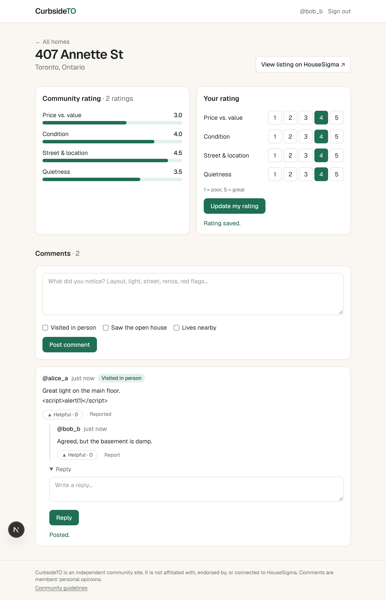

# CurbsideTO

Ratings and comments on GTA homes, from people who've actually seen them. Paste a
HouseSigma listing link, land on that home's page, and add your take.

CurbsideTO is independent and not affiliated with HouseSigma.



## How it works

- **One page per address.** The city and street address are read out of the pasted
  link itself (`/on/toronto-real-estate/407-annette-st/home/…`). Nothing is fetched
  or copied from HouseSigma: no photos, prices or sold history. Each page links back
  to the listing.
- **Ratings.** Each member scores a home 1–5 on price vs. value, condition,
  street & location, and quietness. The page shows the averages.
- **Comments.** Free-form, with optional tags (visited in person, saw the open
  house, lives nearby), one level of replies, "helpful" votes and a Report link.
- **Invite-only, pseudonymous.** Sign-in is a one-time email link. New members need
  an invite code and pick a handle; emails are never shown.

## Running locally

Needs Node 22+ and a Postgres database.

```bash
cp .env.example .env.local   # then set DATABASE_URL
npm install
npm run db:migrate           # creates the tables (safe to re-run)
npm run invite -- 5 friends  # prints an invite code good for 5 sign-ups
npm run dev
```

Without `RESEND_API_KEY`, sign-in links are printed to the dev server's console
instead of being emailed.

| Command | What it does |
| --- | --- |
| `npm run dev` | Start the dev server on http://localhost:3000 |
| `npm test` | Unit tests |
| `npm run typecheck` / `npm run lint` | Static checks |
| `npm run db:migrate` | Apply `db/schema.sql` |
| `npm run invite -- [uses] [note]` | Create an invite code |

## Deploying

Any Node host plus Postgres works (for example Vercel with Supabase or Neon). Set
the variables from `.env.example`; `RESEND_API_KEY` and `EMAIL_FROM` are required in
production so sign-in emails can be sent. Emails listed in `ADMIN_EMAILS` get a Hide
button on comments.

## Roadmap

1. **Private MVP** (this): paste-a-link, home pages, ratings, comments, invites.
2. **Discovery**: address search, map browse, neighbourhood pages, follow a home.
3. **Public launch**: open sign-up, moderation queue, terms and privacy pages.
4. **Browser extension**: show the CurbsideTO thread alongside HouseSigma listings.
